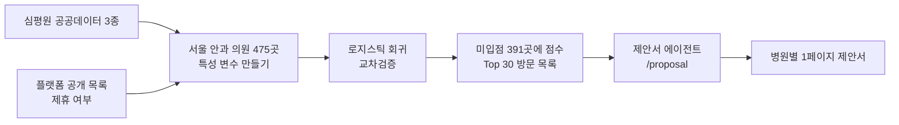
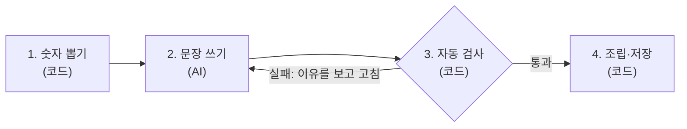

# 어느 안과에 먼저 갈까: 병원 영업 리드 우선순위 정하기

공개 데이터로 병원 플랫폼에 입점할 가능성이 높은 안과를 골라 방문 순서를 정하고, 병원마다 맞춤 제안서를 만드는 AI 에이전트까지 만든 개인 케이스 스터디입니다.

**결과 페이지 바로 보기: https://vivianakim.github.io/clinic-lead-prioritization/**

> 특정 회사와 관계없는 개인 프로젝트이고 공개 데이터만 썼습니다. 병원명은 모두 익명(예: 강남구 A안과)이며, 병원을 특정할 수 있는 수치는 구간으로만 공개합니다.

## 1. 한 줄 요약

서울 안과 의원 475곳을 공공데이터로 분석해 입점 가능성 점수를 만들었고(상위 20%에 실제 입점 병원이 무작위의 3.5배), 이 점수로 아직 입점하지 않은 391곳 중 Top 30 방문 목록과 병원별 제안서를 만들었습니다.

## 2. 문제 정의

병원 가격·리뷰 플랫폼은 광고하는 병원(입점 병원)이 늘어야 매출이 커집니다. 그런데 서울에만 안과 의원이 475곳이고, 영업 담당자가 만날 수 있는 병원 수는 한정되어 있습니다.

- **문제:** 어느 병원부터 찾아가야 계약 가능성이 높은지를 감이 아니라 데이터로 정하고 싶다.
- **왜 중요한가:** 무작위로 고르면 6곳 중 1곳(17.7%)만 입점하는 유형입니다. 같은 시간에 더 가능성 높은 병원을 만나면 영업 효율이 바로 달라집니다.
- **가설:** 이미 입점한 병원은 개원 연차, 규모, 주변 경쟁, 시술 종류 같은 공개 특성에서 미입점 병원과 다르다. 그렇다면 입점 병원과 닮은 미입점 병원부터 찾아가는 게 낫다.

설계 당시의 문제 정의서는 [docs/PRD.md](docs/PRD.md)에 있습니다.

## 3. 데이터

### 출처

| 데이터 | 출처 | 규모 | 쓴 항목 | 쓰임 |
| --- | --- | --- | --- | --- |
| 전국 병의원 및 약국 현황 (2026-09) | [공공데이터포털, 건강보험심사평가원](https://www.data.go.kr/data/15051059/fileData.do) | 전국 의료기관 79,899곳 | 개설일자, 진료과목별 전문의 수, 좌표, 수술실 병상 수 | 병원 특성 |
| 비급여 진료비용 정보 (2026-11-25 확인) | 심평원 공개 화면 | 서울 안과 수술 항목 신고 기록 6,488행 | 라식·라섹, 다초점 백내장 렌즈 가격 신고 여부 | 병원 특성 |
| 의료장비 상세 현황 (2025-12) | [공공데이터포털, 심평원](https://www.data.go.kr/data/15051055/fileData.do) | | 시력교정·백내장 수술 레이저 보유 | 비교 실험용 |
| 병원 플랫폼 안과 공개 목록 (2026-11-24 확인) | 웹 공개 페이지 | 서울 안과 578곳 (제휴 91곳) | 병원명, 지역, 제휴 여부 | 정답 라벨 |

- 정답 라벨은 국내 병원 가격·리뷰 플랫폼(예: 모두닥)의 공개 제휴 목록을 가정해 만들었습니다. 이용약관과 robots.txt를 확인한 뒤, 로그인 없이 공개 페이지에서 병원명·지역·제휴 여부만 모았습니다.
- 원본은 용량이 크고 병원명이 들어 있어 저장소에 올리지 않습니다. 공공데이터는 위 링크에서 받을 수 있고, 수집 목록의 형식은 [data/sample/](data/sample/)의 가짜 샘플로 볼 수 있습니다.

### 전처리

1. **서울 안과 추리기:** 시도가 서울이고, 안과 전문의가 1명 이상이며, 이름에 '안과'가 들어간 곳 480곳. 재단이 운영하는 대형 안과병원 5곳은 영업 대상의 성격이 달라 빼서 **의원 475곳**을 분석했습니다.
2. **파일 연결:** 심평원 파일끼리는 병원 코드(암호화요양기호)로 이었습니다.
3. **정답 붙이기:** 플랫폼 목록에는 제휴하지 않은 병원도 올라와 있어서, 목록에 있는지가 아니라 '제휴 여부'가 '예'인 곳만 입점(1)으로 봤습니다. 결과는 475곳 중 **입점 84곳(17.7%)**입니다.
4. **이름 매칭:** 병원명과 구로 이었고, 이름이 애매한 11곳은 도로명 주소로 직접 확인했습니다. 심평원 자료와 짝이 맞지 않는 제휴 병원 6곳(자료 이후 개원 추정 등)은 뺐습니다.
5. **변수 만들기:** 개원 연차(2026 − 개설연도), 안과 전문의 수, 좌표로 계산한 반경 1km 안 안과 수, 라식·라섹 가격 신고 여부.

쓰지 않은 데이터도 이유를 남겼습니다. 심평원 교통정보는 서울 안과의 19%만 정보가 있고 거리 표기도 제각각이라 이번 분석에서는 빼고 '역 근처' 가설 후보로 두었습니다.

## 4. 분석

### 방법

- **모델:** 로지스틱 회귀, 변수 4개. 결과를 "어떤 병원이 입점하는가"로 설명할 수 있게 단순하게 유지했습니다.
- **검증:** 층화 5-fold 교차검증을 시드 10개로 반복했습니다. 학습에 쓴 병원으로는 채점하지 않습니다.
- **지표:** 입점 병원이 전체의 일부라 "전부 미입점"이라고만 찍어도 정확도는 높게 나옵니다. 그래서 정확도 대신 **점수 상위 20%(95곳) 안의 실제 입점 비율**과 **무작위 대비 배수**를 봤습니다.
- 분석 환경의 보안 정책이 통계 라이브러리(scipy)를 막아, 로지스틱 회귀·교차검증·AUC를 numpy로 직접 구현했습니다.

### 실험 과정 (가설 → 실행 → 검증 → 반영)

| 사이클 | 가설 | 무작위 대비 배수 | 판단 |
| --- | --- | --- | --- |
| 1 | 개원 초기·경쟁 심함·규모 큼·수술실 있음 → 입점 | 3.42배 | 수술실 제외 (효과 불확실, 빼도 3.48배) |
| 2 | 대형병원은 플랫폼이 필요 없다 / 홈페이지 있는 병원이 입점 | 3.48배 / 3.39배 | 대형병원 제외 채택, 홈페이지 기각 |
| 3 | 수술 주력 병원이 입점 (수술 레이저 보유로 측정) | 3.54배 | 더 직접적인 변수로 대체 |
| 3-b | 수술 주력 병원이 입점 (라식·라섹 가격 신고로 측정) | 3.50배, AUC 0.886 → 0.903 | 최종 채택 |

판단 규칙은 미리 정해 두었습니다: 배수가 오르면 채택, 차이가 작으면 더 단순한 모델. 3-b는 배수 차이(+0.02)만 보면 '차이 없음'이지만, 효과가 크고 AUC가 올랐고 영업 근거로 쓰기 좋아 채택했습니다. 자세한 기록은 [outputs/experiment_notes.md](outputs/experiment_notes.md)에 있습니다.

### 발견

1. **라식·라섹을 하는 의원이 입점합니다.** 가격을 신고한 의원의 입점 비율은 56%, 신고하지 않은 의원은 6%였습니다. 전문의 1명인 작은 의원끼리 비교해도 36% 대 4%였습니다.
2. **"수술실 효과 없음"은 데이터가 가설을 제대로 재지 못한 결과였습니다.** 전문의 3명 이상인 입점 의원의 80%가 심평원 자료에 '수술실 없음'으로 신고돼 있었습니다. 라식·라섹은 별도 레이저실에서 하기 때문으로 보입니다. 이 질문이 사이클 3과 3-b로 이어졌습니다.
3. **다른 조건을 같게 맞춘 효과 (오즈비, 95% 신뢰구간)**

| 특성 | 오즈비 | 95% 신뢰구간 | 쉽게 말하면 |
| --- | --- | --- | --- |
| 라식·라섹 시행 | 7.16 | 3.39~15.10 | 입점 오즈가 약 7배 |
| 안과 전문의 1명 증가 | 1.42 | 1.16~1.73 | 1명당 약 42% 높아짐 |
| 반경 1km 안과 1곳 증가 | 1.07 | 1.04~1.10 | 1곳당 약 7% 높아짐 |
| 개원 연차 1년 증가 | 0.90 | 0.87~0.94 | 1년당 약 10% 낮아짐 (새로 연 의원일수록 높음) |

네 변수 모두 신뢰구간이 1을 넘지 않아 방향이 분명하고, 변수끼리 겹침(VIF)은 모두 2 미만입니다. 전체 표는 [outputs/regression_table.csv](outputs/regression_table.csv)에 있습니다.

## 5. 해결책: 우선순위 목록과 제안서 에이전트

### 전체 흐름



### 제안서 에이전트 (Claude Code 스킬)

Top 30 중 순위를 주면(`/proposal 1 2 3`) 에이전트가 아래 단계를 혼자 진행합니다. AI가 그럴듯한 숫자를 지어내는 것을 막으려고, 숫자는 코드가 계산하고 AI는 그 숫자만 보고 문장을 쓰게 나눴습니다.



- **자동 검사가 막는 것:** 코드가 계산하지 않은 숫자, 병원명 노출, 과장·수수료 표현, 병원을 고른 기준(개원 연차·전문의 수 등) 노출, 가정값의 '(가정)' 누락. 검사가 실제로 무엇을 잡는지는 `src/03_check_demo.py`로 볼 수 있습니다.
- **선정 근거는 내부용:** 병원을 고른 기준은 영업 담당자용 목록에만 둡니다. 제안서에는 지역의 플랫폼 입점 현황, 그 병원이 공개 중인 시술 가격, 손익분기(가정), 상황을 듣는 질문만 들어갑니다.
- **손익분기 예약 건수** = 월 광고비 ÷ (시술가 × 공헌이익률). 월 광고비 100만원 (가정), 라섹 70만원 (가정), 공헌이익률 50% (가정)이면 월 3건 (가정)입니다. 광고는 정액 기준으로만 계산하고, 환자 1명당 수수료 구조는 제안하지 않습니다.
- 익명 샘플 3건: [outputs/public/proposals/](outputs/public/proposals/)

### 분석에 AI 에이전트를 쓴 방식

분석 전 과정을 AI 코딩 에이전트(Claude Code)와 함께 했습니다. 에이전트가 데이터 정리, 코드 작성, 모델 실행, 결과 정리를 맡고, 사이클이 끝날 때마다 멈춰서 결과를 보여 주면 제가 채택·기각과 다음 가설을 정했습니다. 작업 규칙(수집 원칙, 익명화, 교차검증 지표만 보고 등)은 [CLAUDE.md](CLAUDE.md)에 적어 에이전트가 매번 따르게 했습니다. 심평원 비급여 화면 자료는 브라우저 에이전트로 수집했고, 그때 쓴 지시문은 [docs/collect_prompt_npay.md](docs/collect_prompt_npay.md)에 있습니다.

## 6. 결과와 임팩트

| 구분 | 결과 |
| --- | --- |
| 검증: 무작위 대비 배수 | **3.50배** (시드 10개 범위 3.39~3.63) |
| 검증: 상위 20% 정밀도 | **61.9%** (무작위 17.7%) |
| 검증: 상위 20% 포착률 | **70%** (입점 병원 84곳 중 59곳이 상위 20% 안에) |
| 검증: 순위 정확도 AUC | 0.903 |
| 활용: 우선 방문 목록 | 미입점 **391곳 → Top 30**. 30곳 중 24곳이 라식·라섹 시행, 11곳이 강남구 |
| 활용: 제안서 | Top 3 제안서 3건 자동 검사 통과 |

- 검증(475곳 전체)은 "이미 입점한 병원을 위쪽에 모으는가"를 본 것이고, 실제로 찾아갈 곳은 미입점 병원뿐입니다. 두 숫자를 섞어 "475곳 중 95곳만 가면 된다"처럼 쓰지 않았습니다.
- 실제 영업에 적용한 결과(방문·미팅·계약)는 없습니다.

결과 페이지: [바로 보기](https://vivianakim.github.io/clinic-lead-prioritization/) (원본 파일: [outputs/public/portfolio.html](outputs/public/portfolio.html)) · 요약: [outputs/public/summary.md](outputs/public/summary.md)

## 7. 기술 스택

- **언어·분석:** Python, pandas, numpy (로지스틱 회귀·교차검증·AUC·VIF 직접 구현), matplotlib
- **AI 에이전트:** Claude Code (분석 작업, 제안서 생성 스킬 `.claude/skills/proposal/`), 브라우저 에이전트 (공개 화면 수집)
- **수집:** 브라우저 콘솔 스크립트 (`src/collect_browser_snippet.js`)
- **결과 페이지:** HTML, CSS, SVG (외부 라이브러리 없음)

## 8. 실행 방법

```powershell
python -m venv .venv
.venv\Scripts\python -m pip install pandas matplotlib
```

공공데이터를 내려받아 `data/raw/hira_hospitals/`, `data/raw/hira_equipment/`에 넣고, 수집한 목록을 `data/raw/`에 둔 뒤 순서대로 실행합니다. 원본이 없으면 실행되지 않습니다. 목록 형식은 `data/sample/`을 참고하세요.

```powershell
.venv\Scripts\python -X utf8 src\00_collect_partners.py   # 수집 원본(TSV) → data/raw/platform_listing.csv
.venv\Scripts\python -X utf8 src\01_prepare.py            # 서울 안과 목록 + 매칭 → data/processed/eye_clinics.csv
.venv\Scripts\python -X utf8 src\02_model.py cycle3b      # 사이클별 평가 (prep, cycle1, cycle2, cycle3, cycle3b)
.venv\Scripts\python -X utf8 src\02_model.py final        # 최종 모델 → Top 30 (내부용, 공개용)
.venv\Scripts\python -X utf8 src\04_summary_figures.py    # 그림과 변수별 구간표
.venv\Scripts\python -X utf8 src\roi.py                   # 손익분기 계산 (가정값은 옵션으로 변경)
```

- 제안서: Claude Code에서 `/proposal 1 2 3`
- 검사 시연: `.venv\Scripts\python -X utf8 src\03_check_demo.py`
- `.env.example`의 키는 현재 코드에서 쓰지 않습니다.

### 폴더

| 경로 | 내용 | 저장소 |
| --- | --- | --- |
| `data/raw/`, `data/processed/` | 원본, 가공 데이터 (병원명 포함) | 올리지 않음 |
| `data/sample/` | 형식 확인용 가짜 샘플 | 올림 |
| `src/` | 단계별 스크립트 | 올림 |
| `outputs/` | 실험 기록, 회귀 결과, 모델 보고서 | 올림 |
| `outputs/public/` | 공개용 결과 (익명, 구간 표시) | 올림 |
| `docs/` | 문제 정의서, 수집 지시문 | 올림 |

## 9. 한계와 개선 방향

**한계**

- "이미 입점한 병원과 닮은 병원을 무작위보다 잘 찾는가"까지만 확인했습니다. Top 30이 실제로 계약할지는 모릅니다.
- 관계를 본 것이지 원인을 본 것은 아닙니다. 다만 비급여 가격 신고는 법적 의무라, 입점 때문에 신고했을 가능성은 낮다고 봤습니다.
- 입점 병원이 84곳이라 일부 효과의 범위가 넓습니다 (라식·라섹 오즈비 3.39~15.10).
- 반경 1km 안과 수는 강남·서초 상권과 겹쳐, 경쟁 때문인지 상권 때문인지 나누지 못했습니다.
- 목록끼리 병원명과 구로 매칭해 오차가 조금 남을 수 있고, 자료 시점이 2025-12부터 2026-11까지 다릅니다.
- 광고비, 시술가, 이익률, 추천 상품 규칙은 모두 가정입니다.

**개선 방향**

1. Top 30 방문·미팅·계약 결과를 기록하고, 정답을 '입점'에서 '계약'으로 바꿔 다시 학습한다.
2. 실제 상품 단가와 시술가로 손익분기를 다시 계산한다.
3. 비급여 신고 항목을 주력 시술로 보는 방법을 피부과·치과 등 다른 진료과에 적용한다.
4. 영업 담당자 의견을 제안서 자동 검사 규칙으로 쌓는다.
5. 구별 효과나 역세권 변수를 넣어 상권과 경쟁을 나눠 본다.

## 10. 내 역할

개인 프로젝트입니다. 기간: 2026-11-24 ~ 2026-11-26

| 내가 한 일 | AI 에이전트(Claude Code)가 한 일 |
| --- | --- |
| 문제 정의와 가설 수립, 성공 지표 설정 | 코드 작성과 실행 |
| 쓸 공공데이터와 항목 결정, 원본 다운로드 | 파일 연결, 변수 생성, 매칭 후보 추리기 |
| 입점 기준 결정, 애매한 11곳 주소 직접 확인 | 모델 실행, 교차검증, 결과 정리 |
| 사이클마다 채택·기각 판단, "수술실은 왜 효과가 없나" 추가 조사 지시 | 틀린 병원 분석, 추가 조사 |
| 제안서 원칙 결정 (선정 근거 비공개, 정액 광고 기준 등) | 제안서 스킬 구현, 문장 작성 |
| 결과 해석과 표현 검토 | 그래프·결과 페이지 작성 |

가장 기억에 남는 건, 모델이 '효과 없음'이라고 한 결과를 그대로 받아들이지 않고 데이터가 가설을 제대로 재고 있는지 다시 확인한 경험입니다. 수술실 변수를 의심한 덕분에 최종 모델의 가장 강한 변수(라식·라섹 시행)를 찾았습니다.
